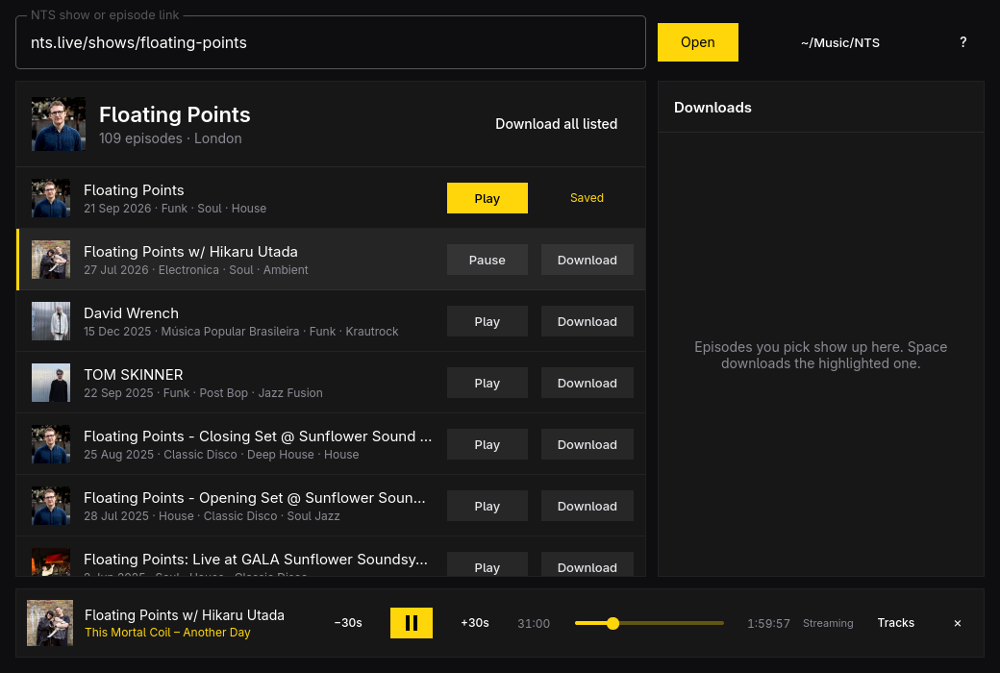

# Rewind



Rewind saves past NTS Radio episodes for offline listening, and plays them.
Paste an nts.live show link to browse its archive, or an episode link to
download it straight away. Each episode keeps the audio exactly as NTS serves
it (usually 160 kbps AAC in an `.m4a`, never re-encoded), with its artwork,
tags (title, show, date, genres), and a tracklist text file when NTS lists
one.

```
~/Music/NTS/Floating Points/2025-12-15 - David Wrench.m4a
~/Music/NTS/Floating Points/2025-12-15 - David Wrench.txt
```

Any episode plays in the window's player bar: from disk when it's saved,
streamed straight from NTS's host when it isn't. The bar shows the track
playing now, from NTS's tracklist (exact times for most tracks, NTS's own
estimates for the rest), and `T` opens the whole tracklist, where a click
jumps to that track. The player remembers where each episode stopped,
streamed or saved, and picks up there next time. MP3s saved by earlier
versions still count as saved and play too.

Downloads run one at a time. Episodes already saved are never overwritten,
and an unfinished download never carries the real file name.

It uses NTS's public API for shows, episodes, and tracklists, `yt-dlp` to
fetch the audio from wherever NTS hosts it (SoundCloud or Mixcloud), and
`ffmpeg` to wrap it with the tags and artwork. The audio belongs to NTS and its hosts; Rewind is
for personal offline listening, not redistribution.

## Install

Rewind has its own pacman repository. On each machine, add it to
`/etc/pacman.conf`:

```ini
[rewind]
SigLevel = Optional TrustAll
Server = https://github.com/andresnta/rewind/releases/download/repo
```

Then install it, and later updates come with every `pacman -Syu`:

```sh
sudo pacman -Sy rewind
```

The packages aren't signed, so pacman takes them on trust from this
repository's GitHub releases. They're built for x86_64.

## Shortcuts

| Key | Action |
| --- | --- |
| `Ctrl+L` | Paste or type a link |
| `Enter` | Open the link |
| `J` / `K` | Move through episodes |
| `Space` | Download the highlighted episode |
| `P` | Play or pause the highlighted episode |
| `←` / `→` | Skip back or forward 30 seconds |
| `T` | Show the tracklist |
| `A` | Download every listed episode that isn't saved yet |
| `M` | Load more episodes |
| `X` | Cancel the running download |
| `R` | Retry failed downloads |
| `C` | Clear finished downloads |
| `O` | Open the download folder |
| `,` | Change the download folder |
| `Esc` | Leave the link field |
| `?` | Show or hide shortcuts |
| `Q` | Quit (asks first while downloading) |

## Command line

```sh
rewind open https://www.nts.live/shows/floating-points
rewind episodes floating-points --limit 10 --json
rewind download https://www.nts.live/shows/<show>/episodes/<episode> --output ~/Music/NTS --json
rewind skill install   # teaches coding agents to use the commands above
```

Each command exits 0 or 1, with errors on stderr.

## Build

Needs `qmake6`, Qt 6 (base, declarative, multimedia, wayland), `yt-dlp`, and `ffmpeg`,
all part of Omarchy or one `omarchy-pkg-add` away.

```sh
bin/build     # build/rewind
bin/test      # Qt Test, offscreen
bin/install   # makepkg -fsi, so it shows up in the app launcher
bin/release   # test, build, and publish to the pacman repository
```

Rewind follows the Omarchy theme (background, accent, and window rounding),
turns see-through like the terminals when windows are set to Glassy, so
Hyprland's blur shows through, and follows the language picked under
Setup > Language (English, Danish, German, and
Mexican Spanish so far).

## License

MIT.
